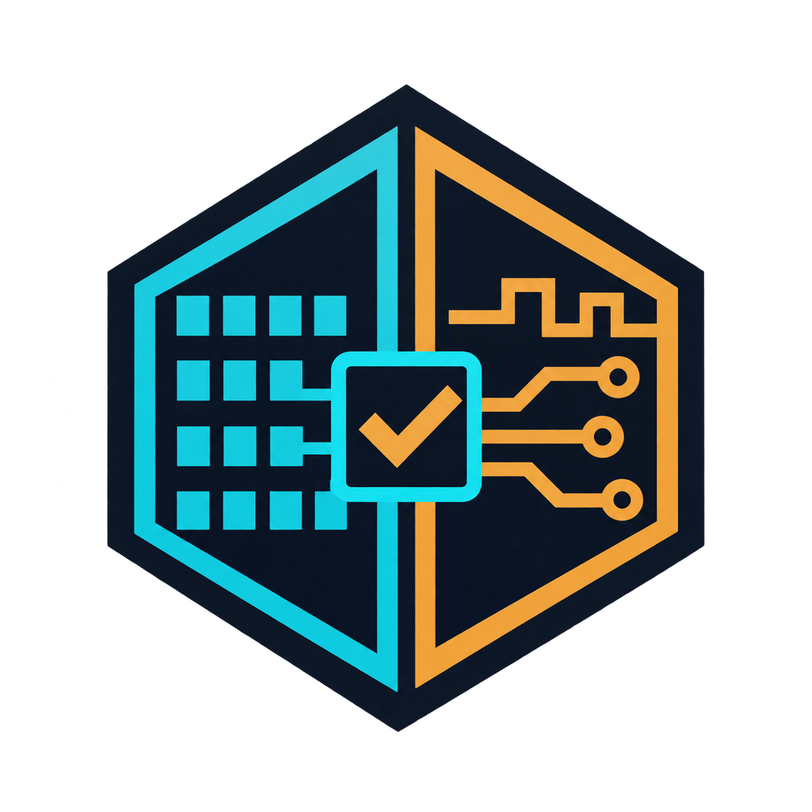

# DisasmLedger

[](https://skills.sh/wagmarsouza/disasmledger)



Skills for traceable binary analysis and firmware test benches. The project contains three independent skills: `binary-analysis-profile` organises target identity, address maps, analysis units, and witnesses; `renode-bench` guides the creation of a Renode bench and the interpretation of program-counter traces; `decompile` orchestrates a staged, grade-gated reconstruction workflow over the other two and schedules work by call-graph closure. They can be used separately or together.

**Local development preview:** optional graph provenance, focused angr routing and versioned bench
capability gating are being developed on this branch. Nothing has been installed or published.
The installation commands below refer to the previously published version, not this preview.
See [the refinement guide](docs/toolchain-refinements.md) and its precise test limits.

## Installation

With Node.js and the [Skills CLI](https://skills.sh/):

```powershell
npx skills add wagmarsouza/disasmledger --skill binary-analysis-profile
npx skills add wagmarsouza/disasmledger --skill renode-bench
npx skills add wagmarsouza/disasmledger --skill decompile
```

For the complete reconstruction workflow, install all three skills above. A single-skill install does not automatically install sibling skills or external tools. See the [Decompile guide](docs/decompile.md) for commands, the grade ladder, dependencies, and migration to version 0.3.0.

Catalog pages: [Binary Analysis Profile](https://skills.sh/wagmarsouza/disasmledger/binary-analysis-profile), [Renode Bench](https://skills.sh/wagmarsouza/disasmledger/renode-bench), and [Decompile](https://skills.sh/wagmarsouza/disasmledger/decompile).

To clone the repository and use the scripts without an agent:

```powershell
git clone https://github.com/wagmarsouza/disasmledger.git
cd disasmledger
python -B -m unittest discover -s skills/binary-analysis-profile/tests -v
python -B -m unittest discover -s skills/renode-bench/tests -v
python -B -m unittest discover -s skills/decompile/tests -v
```

## Binary Analysis Profile

Read [the skill](skills/binary-analysis-profile/SKILL.md) and the templates in `skills/binary-analysis-profile/assets/templates/`. Complete the manifests with data from your own target; the bundled examples are synthetic.

```powershell
$b = '.\skills\binary-analysis-profile\scripts\binary_profile.py'
$p = 'C:\your-project'
python -B $b --project $p inspect --binary 'evidence\image.bin'
python -B $b --project $p target --input "$p\analysis\target.json"
python -B $b --project $p unit --target "$p\analysis\target.json" --input "$p\analysis\unit.json"
python -B $b --project $p witnesses --target "$p\analysis\target.json" --unit "$p\analysis\unit.json" --input "$p\analysis\witnesses.json"
```

The helper checks declared consistency and links manifests to files. It does not disassemble the binary, identify its architecture, authenticate logs, or establish semantic truth. The [synthetic pilot](skills/binary-analysis-profile/examples/run_pilot.py) verifies the workflow without real firmware:

```powershell
python -B skills/binary-analysis-profile/examples/run_pilot.py
```

## Renode Bench

Read [the skill](skills/renode-bench/SKILL.md) and [the usage guide](skills/renode-bench/references/usage.md). Renode is an external dependency. Copy `boot-trace.resc` into your project, then replace and review every platform, address, and firmware marker before running it.

```powershell
$renode = 'C:\Program Files\Renode\bin\Renode.exe'
$bench = 'C:\your-project\bench\boot-trace.resc'
& $renode --disable-gui --console $bench
python -B .\skills\renode-bench\scripts\analyze_trace.py 'C:\your-project\bench\trace-pc.log'
```

The trace analyser is read-only. Program-counter frequency helps select regions for investigation; emulation does not validate real hardware.

To verify a *reconstruction* rather than characterise the original, the skill also ships `scripts/differential.py`: it recompiles a candidate C++ body to a position-independent Thumb blob, loads it into RAM, forced-invokes it on the same bench, and checks the outputs against the stock witnesses under the two-witness discipline. Execution is a pluggable `invoke`, so the same harness drives a Renode forced-invoke engine or a Unicorn runner; it pairs with the `decompile` scheduler (`closure.py` schedules, `differential.py` proves). The offline self-check needs no bench and no cross-toolchain:

```powershell
python -B .\skills\renode-bench\scripts\differential.py --selftest
```

## Decompile

Read [the skill](skills/decompile/SKILL.md) and the references in `skills/decompile/references/` (methodology, toolchain routing, and differential testing). It is an orchestrator: it does not disassemble, execute, or grade anything itself. It distinguishes G0 discarded, G1 raw, G2 semantic hypothesis, G3 compiles, G4-stock original observations, and G4-recon reconstruction comparisons, and composes `binary-analysis-profile` and `renode-bench` for the evidence steps.

The closure scheduler consumes a declared call graph and a declared grade map — produced by your own tools, in the formats shown in `skills/decompile/assets/templates/` — and reports which units are differentially testable now (their callee-closure is already reconstructed) and which undone helpers carry the most leverage:

```powershell
$c = '.\skills\decompile\scripts\closure.py'
$p = 'C:\your-project'
python -B $c --project $p report --callgraph "$p\analysis\callgraph.json" --grades "$p\analysis\grades.json"
```

It never establishes semantic truth or promotes a grade; `evidence_verified`, `semantic_truth_verified`, and `promotion_authorized` are always false. Report-v2 separates original and reconstruction grades, excludes G0 from live counts, and blocks unknown dependencies. Read the [migration guide and evidence boundaries](docs/decompile.md#migration-from-020-to-030) before using its counts or readiness suggestions. The [synthetic pilot](skills/decompile/examples/run_pilot.py) verifies the scheduling arithmetic without real firmware:

```powershell
python -B skills/decompile/examples/run_pilot.py
```

## Census presentation — local preview

For a monochrome text view of the same declared census, use the optional
[census bars guide](skills/decompile/references/census-presentation.md):

```powershell
python -B skills/decompile/scripts/census_bars.py --project PROJECT_ROOT --callgraph analysis/callgraph.json --grades analysis/grades.json --ascii
```

This presentation preserves closure calculations and separates G4-stock/G4-recon. It does not
reconcile or edit anything and does not claim that declared grades have been independently verified.

## Using DisasmLedger with VeriMission

The local preview also includes an optional [8.2 observation adapter](skills/decompile/references/verimission-adapter.md).
It translates declared grade snapshots into native observations and checks frozen source bindings;
it never copies VeriMission's reconciler or edits mission state. G4-stock stays distinct from
reconstruction, and G0 exclusions/denominator are fixed per declared epoch. No installation,
publication or live migration has been performed. See [verification](docs/verimission-adapter-verification.md).

[VeriMission](https://github.com/wagmarsouza/long-project-agent-harness) is optional. It coordinates long-running missions, acceptance criteria, claims, and retractions. DisasmLedger does not include the VeriMission executor and does not depend on it to run its helpers. If you use both projects, read the [optional integration guide](skills/binary-analysis-profile/references/v8-integration.md) and consult the installed harness version: canonical state and commands belong to that version.

## Scope and distribution

- The package publishes templates and synthetic tests. It contains no firmware, dumps, credentials, personal logs, or private hardware configuration.
- Preserve the original binary, identify its hash, and document its origin, configuration, observations, inferences, contradictions, and coverage denominator.
- Third-party tools, including Renode, have their own installation procedures and terms.
- This repository does not include a licence file. Public availability alone does not grant general permission to redistribute or modify the work; selecting a licence requires an explicit decision by the author.

The name DisasmLedger reflects the link between bytes, observations, and auditable conclusions. The logo was created for this project.
